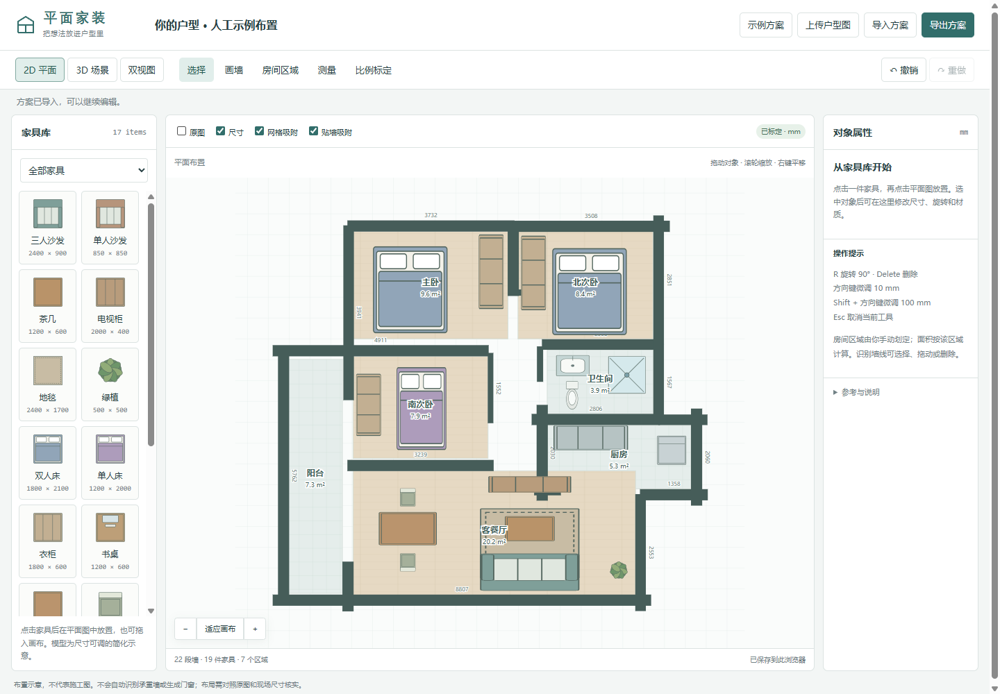
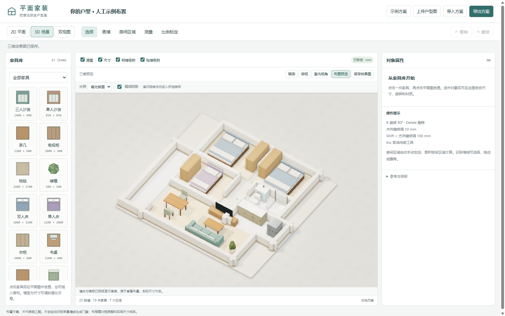
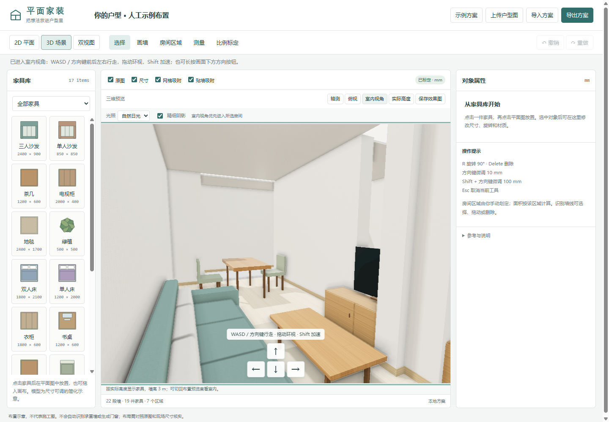

# Floorplan 3D · 平面家装工作台

一个在本地运行的户型识别与家装布置工具：上传平面户型图，提取墙线，标定真实尺寸，在二维画布中摆放家具，再通过三维全屋视图和室内漫游查看布局。

基于 [rslywhj/floorplan-3d](https://github.com/rslywhj/floorplan-3d) 扩展，保留 Flask + OpenCV 图片识别流程，补充二维编辑、家具库、材质渲染、室内行走和方案保存。

> 当前定位是可编辑的家装布局与实时渲染原型。图片识别不会读取尺寸文字或识别门窗；墙线修正闭合后可识别房间，门窗和家具需人工放置。

## 产品截图

以下为项目实际运行截图。示例中的家具和房间区域为人工布置，不是上传图片后自动生成的装修方案。

### 二维户型与家具布置

左侧选择家具，在画布放置；选中对象后可编辑尺寸、角度和颜色。区域面积根据手工划定的范围与标定比例计算。



### 全屋材质预览

木纹地面、家具材质、灯光和接触阴影。截图使用「布置预览」，降低了墙体和高柜的显示高度，方便查看室内；默认「实际高度」模式的墙高为 **3 米**。



### 室内视角与行走

进入室内后可用键盘或画面下方方向按钮前后左右行走，拖动鼠标原地环视。



## 功能

- **户型图片识别**：上传 PNG、JPG/JPEG、BMP 或 WebP，提取横竖墙线及厚度，支持中文文件名。
- **二维编辑**：新建空白户型，连续画墙、定长输入、长度预览、网格和端点吸附；编辑墙体端点、厚度、高度及人工承重标记，共用端点联动。
- **门窗与洞口**：点击墙体放门窗，沿墙拖动，调整宽高、中心位置和窗台高；三维生成真实洞口，禁止越界和洞口重叠。
- **房间区域**：识别闭合直线墙围成的多边形房间，支持共享隔墙和凹形轮廓，可随墙更新；也可手工划定矩形区域。
- **比例标定**：指定原图上两个点，输入它们之间的实际毫米长度。
- **17 类家具**：覆盖客厅、卧室、餐厨、卫浴，支持放置、拖动、旋转、复制、尺寸、颜色和锁定。
- **辅助布置**：50 mm 网格吸附、横竖墙贴墙吸附、快捷键微调、撤销和重做。
- **二维／三维联动**：平面、三维或双视图；轴测、俯视和室内视角。
- **实时材质渲染**：程序生成的木纹、石纹、布料和墙面纹理，环境反射、SSAO 接触阴影、自然日光与暖光预设。
- **室内行走**：WASD／方向键、Shift 加速、屏幕方向按钮、鼠标环视和滚轮前进后退。
- **方案保存**：浏览器自动保存、JSON 导入导出、当前三维效果图 PNG 导出。

## 技术栈

| 层级 | 技术 | 用途 |
| --- | --- | --- |
| 前端界面 | HTML、CSS、原生 JavaScript ES Modules | 编辑工作台与交互 |
| 二维画布 | SVG | 墙线、家具符号、区域、尺寸标注 |
| 三维场景 | Three.js 0.126.1、WebGL | 模型、材质、相机与漫游 |
| 渲染增强 | EffectComposer、SSAOPass、PMREM | 接触阴影与预过滤环境反射 |
| 本地数据 | localStorage、JSON | 自动保存与方案交换 |
| 后端 | Python、Flask、Flask-CORS | 图片上传与识别接口 |
| 图像处理 | OpenCV、NumPy | 提取墙线、坐标和厚度 |

项目没有使用 Vue、React、数据库或 AI 识别模型。启动前端不需要 Node.js。Three.js 及渲染组件已放在 `frontend/vendor/`，页面加载无需访问 CDN。

## 本地启动（Windows / PowerShell）

准备 Python 和支持 WebGL 的现代浏览器。下面以项目目录 `D:\wang_work\floorplan-3d-project` 为例；如果项目放在其他位置，请替换路径。

### 1. 首次安装依赖

在项目根目录执行；已有可用 `.venv` 时无需重新创建。

```powershell
cd D:\wang_work\floorplan-3d-project
python -m venv .venv
& .\.venv\Scripts\python.exe -m pip install -r .\backend\requirements.txt
```

### 2. 启动后端

打开一个 PowerShell 窗口：

```powershell
cd D:\wang_work\floorplan-3d-project\backend
& ..\.venv\Scripts\python.exe -m flask --app app run --host 127.0.0.1 --port 5000
```

### 3. 启动前端

再打开一个 PowerShell 窗口：

```powershell
cd D:\wang_work\floorplan-3d-project\frontend
& ..\.venv\Scripts\python.exe -m http.server 8000 --bind 127.0.0.1
```

浏览器访问 **[http://127.0.0.1:8000/](http://127.0.0.1:8000/)**。保持两个窗口运行，按 `Ctrl+C` 停止对应服务。

前端使用 ES Modules，请通过 HTTP 服务访问，不要直接双击 `index.html`。上述命令用于本地开发与演示。后端接口为 `http://localhost:5000/upload`，地址目前写在 `frontend/app.js` 中；更换后端端口时需同步修改。

## 使用流程

1. **体验示例或上传户型图**：点击「示例方案」可直接尝试家具编辑；使用自己的图片时点击「上传户型图」。上传请求上限为 20 MB。
2. **标定比例**：上传后会展示完整原图，引导点选一段尺寸标注的两个端点。输入原图标注的实际长度并选择单位，例如 `9255 mm` 或 `9.255 m`。弹窗会预览换算后的户型范围及家具相对大小变化，确认后应用。标定完成前不能新增家具和门窗。
3. **修正墙线**：检查识别结果，拖动、删除误检墙线，或使用「画墙」连续补线；按住 Shift 可画斜墙，Esc 结束。绘墙栏可输入毫米长度，右侧属性可编辑端点、墙高和厚度。
4. **放门窗、划分房间**：点击「放门」或「放窗」后点击墙线。门窗会切出三维洞口；在属性中设置尺寸和窗台高。墙体闭合后点击「识别房间」，或用「手工区域」指定矩形两个对角，再设置名称和地面材质。
5. **摆放家具**：点击家具卡片，再点击二维图放置，也可直接拖入画布；选中后在右侧修改属性。
6. **查看效果**：切换「3D 场景」或「双视图」，选择轴测、俯视、室内视角和光照预设。
7. **保存方案**：编辑会自动保存到当前浏览器；点击「导出方案」备份 JSON，之后可用「导入方案」继续编辑。「保存效果图」导出当前三维画面。

### 尺寸与面积

- 家具宽、深、高和墙线属性使用 **毫米（mm）**；房间面积显示为 **平方米（m²）**。
- 新上传图片未标定时，默认暂按 **1 像素 = 10 mm** 显示，并标记为「未标定」。这不是自动识别出的真实比例。
- 上传图上方显示当前比例和户型换算范围。觉得家具过大或过小时，点击「复核 / 校正比例」，对照原图长尺寸线重新标定；不要用缩小家具尺寸代替校正户型比例。参考线和实际长度会随方案保存，旧方案没有参考线时可重新点选。
- 标定后，家具的毫米尺寸保持不变，户型与家具的相对比例会更新。
- 手工区域面积按矩形计算；自动房间面积按墙中心线多边形计算，不是净使用面积或建筑面积，没有扣除墙体占地或计算公摊。
- 三维墙高默认 **3 m**，每段墙可独立修改。「布置预览」将墙体显示高度限制为 0.65 m，高物件限制为 1.05 m，不修改保存的尺寸。
- 门窗尺寸和距墙起点的位置使用毫米，位置指洞口中心；重新标定后仍保留毫米值。缩短墙体、降低墙高或重新标定导致洞口越界时，修改会被拒绝。删除墙体会同时删除关联门窗，可撤销恢复。
- 自动房间支持相交直线墙和 T 形交点，但不会跨越墙线缺口；识别前应先补墙。嵌套内庭暂不支持。开启「房间随墙更新」后，自动房间由墙体派生，不能直接拖动；手工区域保留，不会自动替换。

### 快捷操作

| 场景 | 操作 | 效果 |
| --- | --- | --- |
| 二维编辑 | 拖动对象 | 移动墙线、区域或家具 |
| 二维编辑 | 滚轮／右键拖动 | 缩放／平移画布 |
| 选中家具 | R | 旋转 90° |
| 选中对象 | Delete | 删除；锁定家具需先解锁 |
| 选中家具 | 方向键／Shift + 方向键 | 微调 10 mm／100 mm |
| 编辑 | Ctrl + Z／Ctrl + Shift + Z | 撤销／重做 |
| 绘制或放置 | Esc | 取消当前工具 |
| 室内视角 | W、S 或 ↑、↓ | 前进、后退 |
| 室内视角 | A、D 或 ←、→ | 左右平移 |
| 室内视角 | Shift + 移动键 | 加速行走 |
| 室内视角 | 鼠标拖动／滚轮 | 原地环视／前进后退 |
| 室内视角 | 长按屏幕方向按钮 | 持续移动，松开停止 |

**室内行走需先进入「3D 场景 → 室内视角」，再点击三维画面。** WASD 是键盘字母键；画面底部也有方向按钮。输入属性时不会触发行走。可先选择房间区域，再进入对应房间；默认优先进入客餐厅。当前为自由漫游，没有墙体或家具碰撞限制。

## 数据与保存

- 后端将上传图片保存到根目录 `uploads/`，成功上传的文件会保留在本机；该目录的运行数据已被 Git 忽略。
- `backend/debug.png` 为最近一次识别的调试图，每次成功识别会覆盖。
- 方案自动保存于当前浏览器、当前站点的 localStorage。不同浏览器、端口或 `localhost`／`127.0.0.1` 地址之间不共享缓存。
- 清理站点数据会删除浏览器中的方案，请用 JSON 导出备份。导出包含底图、墙线、家具、区域、尺寸比例和测量数据。
- 刷新保留方案，不保留撤销历史。导入方案、新上传图片或载入示例后，可在当前会话中撤销返回之前的方案。
- 方案 JSON 上限为 15 MB，仅支持本项目的格式；不兼容酷家乐或其他设计工具的工程文件。
- 原有版本 1 方案仍可读取，无门窗数据时按空列表处理，无墙高时按 3000 mm 显示。门窗、多边形房间和墙高均随 JSON 保存。
- 每次编辑提交都会校验：最多 3000 段墙、500 件家具、500 个门窗、200 个区域和 500 个测量；自动房间模式最多 600 段墙。超限操作回退，不覆盖上一个有效方案。恢复缓存失败时暂停自动保存，先通过「备份原缓存」保留原始内容。

## 项目结构

```text
floorplan-3d-project/
├── backend/
│   ├── app.py                 # Flask 上传接口
│   ├── parse_floorplan.py     # 墙线识别
│   └── requirements.txt
├── frontend/
│   ├── index.html             # 工作台入口
│   ├── editor.css             # 布局与样式
│   ├── app.js                 # 编辑交互与视图联动
│   ├── core.mjs               # 方案模型、家具目录、标定、历史
│   ├── plan.mjs               # 吸附、门窗约束、墙段、房间拓扑与面积
│   ├── building.mjs           # 三维墙体开洞、门窗与多边形地面
│   ├── furniture.mjs          # SVG 符号与三维家具
│   ├── surfaces.mjs           # 程序纹理、材质、倒角几何
│   ├── view3d.mjs             # 相机、灯光与渲染
│   ├── walk.mjs               # 室内行走与环视
│   └── vendor/                # Three.js 及官方渲染组件、许可证
├── docs/images/               # README 产品截图
├── uploads/                   # 运行时上传数据
├── DESIGNER.md                # 编辑器详细说明
├── RENDERING.md               # 渲染实现、参考与限制
└── README.md
```

## 上传接口

`POST /upload`，请求类型为 `multipart/form-data`，文件字段名为 `file`。

返回示例（数值仅示意）：

```json
{
  "walls": [
    {"id": "w1", "x1": 120, "z1": 80, "x2": 480, "z2": 80, "thickness": 12}
  ],
  "bounds": {"x": 100, "y": 60, "width": 500, "height": 400},
  "image_size": {"width": 1000, "height": 800}
}
```

墙线坐标、厚度和范围均使用**原图像素单位**，其中 `z` 对应图片纵向坐标；真实尺寸由前端标定比例换算。缺少文件、格式不支持或图片无法读取时返回 `400`，超过请求大小限制时返回 `413`；错误结构为 `{"error":"错误说明"}`。

## 常见问题

- **界面更新未生效或看不到行走按钮**：使用 `Ctrl+F5` 强制刷新，再进入「室内视角」。
- **能编辑但无法上传识别**：确认 Flask 后端在 5000 端口运行；检查前端请求地址是否一致。
- **尺寸或家具比例不对**：先用原图明确标注的一段长度完成比例标定，再检查家具摆放。
- **三维操作卡顿**：关闭「精细阴影」，减少家具数量，或使用单独的 3D 视图。
- **端口被占用**：不要重复启动同一服务；在原服务窗口按 `Ctrl+C` 停止后再启动，或调整端口并同步前端地址。

## 当前限制

图片识别适合墙线清晰、对比明显的户型图，可能误检或漏检；没有 OCR 尺寸识别、自动补齐墙体缺口或承重判断。门窗需人工放置，门扇目前固定为打开的示意状态。房间识别按直线墙中心线求闭合区域，不支持弧墙或带内庭的嵌套轮廓；临时顶面仅用于室内预览。

家具为自制参数化简化模型。渲染采用实时 WebGL 与展示光照预设，没有接入路径追踪、真实日照分析或品牌模型库，不能作为施工图或照片级装修结果。吸附不会阻止家具重叠，室内漫游也没有碰撞检测。

## 开源来源与参考

- [原始 floorplan-3d 项目](https://github.com/rslywhj/floorplan-3d)：户型图片转三维的基础项目。
- [Three.js](https://github.com/mrdoob/three.js/tree/r126)：实际使用的三维引擎与渲染组件；第三方 MIT 许可证见 [frontend/vendor/LICENSE](frontend/vendor/LICENSE)。
- [Blueprint3D](https://github.com/furnishup/blueprint3d)、[openPlan3D](https://github.com/laanlabs/openPlan3D)、[react-planner](https://github.com/cvdlab/react-planner)：编辑器工作流程参考，未集成其框架或家具资产。
- [three-gpu-pathtracer](https://github.com/gkjohnson/three-gpu-pathtracer)、[drei-vanilla](https://github.com/pmndrs/drei-vanilla)：渲染方案研究参考，当前未接入这些库。

更多说明：[编辑器使用说明](DESIGNER.md) · [渲染功能说明](RENDERING.md)
